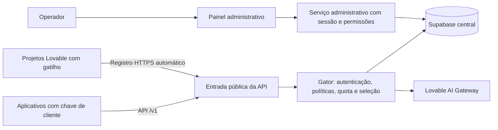

# Plano de evolução administrativa do Gateway

Data: 22/10/2026. Estado: proposta de implementação baseada no código publicado, na instalação existente e na documentação primária do OmniRoute e do 9Router. Este documento organiza o plano mestre; não declara as fases abaixo concluídas. Nesta etapa não foram alterados serviços, credenciais ou banco de produção.

## 1. Resultado esperado

O operador consegue administrar o gateway pelo navegador: cadastrar e bloquear clientes, emitir e revogar suas chaves, organizar as chaves Lovable recebidas dos projetos, definir modelos e políticas, acompanhar consumo e investigar falhas. Toda configuração exibida como salva precisa persistir e afetar o comportamento da API.

Dois acessos permanecem:

- Painel: `https://secretsof.delvertokens.store`.
- API dos aplicativos: `https://api.delvertokens.store/v1`.

O cliente utiliza sua chave emitida pelo painel. O servidor escolhe uma chave Lovable do pool. As duas credenciais têm finalidades diferentes. O projeto Lovable pode ter qualquer interface, desde que possua o gatilho e um runtime com a própria chave. O remix não precisa de GitHub nem de segredo compartilhado individual. O registro automático deve continuar sendo o padrão.

“Totalmente administrativo” significa que as operações diárias ficam disponíveis no painel. Deploy, acesso SSH, chaves mestras de cifra e restauração de desastre continuam com procedimentos operacionais controlados; o painel não será um terminal root ou um editor arbitrário de ambiente.

## 2. Diagnóstico da base atual

| Área                 | Evidência atual                                                               | Lacuna a resolver                                                                |
| -------------------- | ----------------------------------------------------------------------------- | -------------------------------------------------------------------------------- |
| Hospedagem           | Painel e API públicos com HTTPS; health HTTP 200 na conferência desta etapa   | Monitoramento, renovação de certificado e recuperação ensaiados                  |
| Separação de acessos | API bloqueia administração; criação/suspensão de cliente já testadas          | Separar também permissões e sessão administrativa                                |
| Login                | Token administrativo informado na interface                                   | Login individual, sessões, permissões e auditoria                                |
| Chaves de cliente    | `gateway_clients.client_key` é lida e exibida completa pela administração     | Hash, exibição única, múltiplas chaves por cliente, rotação e expiração          |
| Pool Lovable         | Receptor, validação upstream e cifra por RPC; teste sintético de idempotência | Primeiro registro real e inferência real ainda não comprovados                   |
| Cadastro do remix    | Destino HTTPS herdável já está no código                                      | Publicar a origem atualizada no Lovable; remix antigo tem gatilho anterior       |
| Motor de inferência  | Rotas de compatibilidade no pai e seleção de chave existente                  | Gator ainda atende registro/health; falta pipeline único de inferência           |
| Limites              | Campos e verificações parciais existem                                        | SQL local de quota não reserva consumo atomicamente; concorrência não comprovada |
| Modelos              | Catálogo e aliases no código; lista adicional fixa no painel                  | Uma única fonte persistida, capacidades verificadas e política por cliente       |
| Navegação            | Telas selecionadas por estado em `src/routes/index.tsx`                       | Rotas próprias; alguns menus compartilham o mesmo formulário ou resumo           |
| Telemetria           | Consulta administrativa dos últimos 50 logs                                   | Paginação, tentativas, streaming, consumo conciliado e filtros                   |
| Segurança visual     | Tela mostra afirmações fixas com marca de sucesso                             | Indicadores calculados com evidência, data e estado desconhecido                 |
| Trabalho local       | Há alterações funcionais anteriores ainda não revisadas                       | Revisar separadamente do código publicado e não implantá-las em bloco            |

Health aprovado e catálogo HTTP 200 não comprovam geração de IA, saldo nem quota concorrente. A auditoria SQL de RLS/grants do banco central e o ensaio de restauração continuam pendentes.

## 3. Referências: o que adaptar

O [OmniRoute](https://github.com/diegosouzapw/OmniRoute) documenta áreas de gestão de chaves, auditoria, diagnóstico, modelos e requisições. A proposta aproveita essa organização para tornar as ações e seus efeitos visíveis. Referência: [galeria administrativa](https://github.com/diegosouzapw/OmniRoute/blob/main/docs/guides/FEATURES.md).

O [guia do OmniRoute](https://github.com/diegosouzapw/OmniRoute/blob/main/docs/guides/USER_GUIDE.md) descreve estratégias de roteamento, cadeias de fallback, circuit breakers e exportação/importação. Vamos adaptar políticas simples e testáveis ao pool Lovable, sem introduzir todos os mecanismos avançados de uma vez.

O [9Router](https://github.com/decolua/9router) reúne configuração de contas, tradução de formatos, combos, acompanhamento de uso e integração com ferramentas por uma API comum. Vamos usar essa experiência como referência para conexão de aplicativos e gestão do pool.

Esses recursos são descritos pelos projetos de referência; não foram auditados ou reproduzidos integralmente nesta análise. Suas promessas de economia ou disponibilidade não serão tomadas como garantia para este gateway. Inspiração não exige trocar o projeto por um fork; eventual reutilização de código requer conferir licença e preservar atribuições.

| Referência                | Adaptação ao nosso gateway                                    | Prioridade     |
| ------------------------- | ------------------------------------------------------------- | -------------- |
| Gestão de contas/conexões | Projetos, credenciais Lovable e agrupamento por workspace     | Alta           |
| Gestão de API keys        | Cliente com várias chaves, escopos, validade e revogação      | Alta           |
| Diagnóstico               | Estado real de banco, pool, certificado e upstream            | Alta           |
| Roteamento/fallback       | Ordem de chaves/modelos, cooldown e simulação                 | Alta           |
| Analytics e logs          | Uso por cliente, chave, projeto, modelo e período             | Alta           |
| Playground                | Testar a própria API e explicar qual rota foi escolhida       | Média          |
| Token Saver               | Experimento opcional, com medição e preservação de tool calls | Posterior      |
| Diversos provedores/OAuth | Fora desta versão: Lovable permanece o upstream único         | Fora do escopo |

## 4. Arquitetura de destino

Manter os três serviços leves existentes durante a transição. O pai deixa gradualmente de executar inferência e passa a servir painel e administração; a entrada da API passa a encaminhar inferência ao Gator. Migrar primeiro texto, depois mídia. O caminho antigo permanece disponível internamente para retorno, sem executar duas inferências para o mesmo pedido.

Separar a distribuição do gatilho do produto administrativo: módulo copiável e template mínimo com os módulos de envio, sem rotas administrativas ou credenciais centrais. Começar no repositório atual; criar outro repositório só se necessário depois de builds independentes aprovados. Filhos existentes precisam de atualização do código; mudanças na origem não são retroativas.

## 5. Menu administrativo proposto

| Tela                    | Operações e informações obrigatórias                                                              |
| ----------------------- | ------------------------------------------------------------------------------------------------- |
| Visão geral             | Pedidos, erros, latência p50/p95, consumo, capacidade do pool e incidentes no período             |
| Clientes                | Criar/editar/suspender, plano de limites, modelos permitidos e histórico                          |
| Chaves dos clientes     | Emitir, copiar uma vez, expirar, revogar, rotacionar e ver último uso                             |
| Projetos e pool Lovable | Origem, workspace declarado, hint, última validação, último uso, cooldown, ativar/pausar e testar |
| Cadastro de remixes     | Versão do gatilho, URL da central, tentativas, motivo de falha e instruções para publicação       |
| Modelos                 | ID real, aliases, capacidades, estado do último teste, visibilidade e permissão por cliente       |
| Rotas e fallback        | Prioridade, distribuição entre chaves, rota/modelo permitido, limites de tentativas e simulação   |
| Limites e consumo       | RPM, simultaneidade, requisições/tokens por dia/mês e consumo reservado/confirmado                |
| Uso e custos            | Agrupamento por cliente/projeto/modelo, exportação e distinção entre medido/estimado/desconhecido |
| Requisições             | Busca por request ID, filtros, paginação e detalhe de cada tentativa                              |
| Playground              | Texto e streaming pela mesma API; sem privilégios para ignorar políticas do cliente               |
| Jobs e mídia            | Só capacidades validadas; estado, cancelamento suportado, expiração e isolamento por cliente      |
| Equipe e auditoria      | Administrador, operador e leitura; sessões e registro das alterações                              |
| Sistema                 | Saúde, versões, certificado, alertas, backups e diagnóstico sem valores de segredos               |

Todas as telas terão URL própria, estados de carregamento/erro/vazio/sucesso, busca e paginação quando necessário. Ação em lote deverá indicar itens afetados e resultados individuais. Alteração de limites/políticas deverá mostrar o efeito e gerar auditoria. Recursos ainda não implementados ficam identificados como indisponíveis, sem indicadores fixos de sucesso.

## 6. Entregas na ordem de execução

### E0 — Comprovar o ciclo real e fixar o ponto de partida

- Revisar o que está publicado e separar o trabalho local anterior.
- Publicar no Lovable a origem com gatilho automático atualizado e destino HTTPS atual.
- Criar/publicar/visitar um remix, conferir um registro cifrado sem duplicação e realizar uma chamada curta pela API com chave de cliente.
- Registrar resultado, erro se houver, latência e consumo; nunca registrar a chave. Se o runtime não fornecer `LOVABLE_API_KEY`, tratar isso como bloqueio explícito da integração.
- Inventariar tabelas/RPCs e executar auditoria SQL com acesso ao projeto central correto; preparar ambiente de teste e backup restaurável antes das migrations.

**Aceite:** um projeto real cadastrado, uma resposta de IA real e consumo identificado, ou bloqueio técnico documentado sem chamar a integração de pronta. Alterações do painel que não dependam desse ciclo podem avançar enquanto a publicação Lovable estiver pendente.

### E1 — Login administrativo e chaves seguras

- Substituir token administrativo digitado no navegador por login individual e sessão no servidor, com cookie HttpOnly/Secure, expiração, logout e proteção de requisições de alteração. Prever MFA e recuperação controlada do administrador.
- Perfis: administrador altera segurança/equipe; operador gerencia pool e clientes dentro das permissões; leitura consulta indicadores sem exportar segredos.
- Separar cliente e suas chaves: armazenar hash da chave aleatória, hint, data, expiração, status e último uso; exibir o valor somente ao criar/rotacionar.
- Fazer migração compatível das chaves antigas: backfill no servidor, validação por hash, retirada do texto aberto e encerramento do caminho legado. Não exigir troca inesperada de todas as integrações.
- Auditoria com ator, ação, recurso, data, request ID e campos alterados sem segredos. Configuração versionada para evitar sobrescrita silenciosa por dois operadores.

**Aceite:** operador sem permissão recebe 403; chave de cliente não abre administração; valor completo não volta em listagem/log/exportação; rotação e revogação testadas; sessão encerrada deixa de alterar dados.

### E2 — Motor único, políticas e quotas concorrentes

- Criar pipeline no Gator: autenticar → validar capacidade/modelo → aplicar limite → reservar quota → selecionar chave → chamar upstream → reconciliar consumo → registrar resultado.
- Iniciar com `/v1/models`, `/v1/chat/completions` e `/v1/messages`; Responses só após compatibilidade comprovada. Remover duplicação progressivamente.
- Quota no banco por operação atômica com reserva identificada, confirmação/liberação idempotente, recuperação de reservas abandonadas e janela diária/mensal definida. Reservar máximo de tokens permitido e reconciliar com uso real quando disponível.
- Rate limit e simultaneidade por cliente/chave, não por header de IP fornecido pelo cliente. Compartilhar contagem entre processos; começar com Postgres e adicionar Redis dedicado somente se a medição justificar.
- Deadline, cancelamento, limite de payload e streaming íntegro. Nunca trocar modelo/chave depois de enviar conteúdo ao cliente. Timeout não prova que o upstream deixou de cobrar: retry precisa considerar esse estado incerto.

**Aceite:** pedidos concorrentes não excedem a quota reservável; retries não duplicam cobrança interna; cliente suspenso e modelo proibido são recusados; teste de stream interrompido/cancelado; ausência de chave elegível retorna erro claro.

### E3 — Pool Lovable administrável

- CRUD de metadados do projeto/workspace e ações para pausar, reativar, validar e acompanhar falhas; excluir/desvincular com histórico preservado.
- Mostrar separado: aceitação da credencial, estado de uso e saldo desconhecido. 429 não comprova saldo nem esgotamento de crédito; tratar `Retry-After` quando houver. 402 indica restrição de crédito; 401/403 exigem classificação antes de desabilitar definitivamente.
- Round-robin inicial, prioridade e pesos opcionais; cooldown e circuit breaker com estados visíveis, última falha e próxima tentativa.
- Agrupar créditos por workspace declarado, sem somar saldo como independente apenas porque existem várias chaves/remixes. Só identificar vínculo como verificado quando houver evidência do provedor.
- Continuar cadastro automático sem segredo por filho. A origem é rótulo, não prova de propriedade; qualquer credencial válida apresentada ao endpoint pode entrar no fluxo. Limitar tentativas/contribuição, auditar novas origens e permitir políticas centrais opcionais de admissão sem transformá-las em configuração manual obrigatória de cada remix.
- Probes com frequência limitada e aviso de consumo; sem testar todas as chaves em cada atualização da tela. Exibir última validação, não uma falsa presença online do remix.

**Aceite:** suspensão remove imediatamente a chave da seleção; cadastro repetido não duplica; estado de cooldown expira corretamente; revalidação não ignora política de desativação manual; chaves nunca aparecem no navegador.

### E4 — Modelos, rotas e painel com ações reais

- Fonte única de catálogo para motor, `/v1/models` e painel; modelos suportados/experimentais/indisponíveis e capacidades específicas.
- Desabilitar modelo, editar alias, atribuir política de cliente e simular seleção sem consumir créditos.
- Fallback de chaves do mesmo modelo por padrão. Mudança para outro modelo exige política explícita e deve aparecer no resultado operacional; nada de substituir silenciosamente um modelo solicitado por um diferente.
- Rotas reais do painel, formulários distintos, validação e edição persistida para todos os menus. Corrigir contadores de clientes ativos e retirar indicadores estáticos.
- Construtor de integrações: copiar base URL, exemplo de configuração e chave recém-criada para ferramentas compatíveis, sem prometer compatibilidade de tools/Responses antes do teste.

**Aceite:** configuração salva sobrevive ao reinício e altera a API; catálogo do cliente coincide com sua política; uma simulação explica chave/modelo elegível ou motivo de recusa sem expor credenciais.

### E5 — Consumo, histórico, auditoria e alertas

- Eventos por requisição e por tentativa: IDs correlacionados, cliente/chave/projeto/modelo, status, motivo do fallback, tempo até primeiro token, duração, tokens e reservas.
- Finalização confiável em sucesso, falha, cancelamento e queda do stream; distinguir falha de telemetria da geração de IA. Decidir antes do upstream se o registro de reserva não puder ser garantido.
- Dashboard por intervalo, filtros e paginação no servidor, exportação limitada e retenção configurável. Conteúdo de prompts/respostas desativado por padrão; segredos sempre removidos.
- Custos somente com preço versionado e unidade conhecida; consumo de crédito Lovable não deve ser apresentado como fatura exata. Se não houver informação, mostrar desconhecido.
- Alertas de pool sem chave, excesso de 401/402/429/5xx, erro de banco, certificado próximo do vencimento e disco/memória. Destinos de notificações exigem configuração pelo operador.

**Aceite:** total da interface concilia com registros/reservas; um request ID permite explicar as tentativas; nenhum segredo nos logs; exportação e retenção verificadas.

### E6 — Playground, mídia e economia opcional

- Playground de texto primeiro, usando as políticas do cliente selecionado e indicando consumo.
- Habilitar imagem, embedding, vídeo e áudio apenas conforme endpoint/modelo validado. Recursos assíncronos exigem jobs persistidos, consulta autorizada, limites, limpeza e timeout; ocultar operações não suportadas.
- Token Saver opcional por cliente/rota, com bypass e comparação antes/depois. Preservar instruções, código, JSON e argumentos/resultados de ferramentas; sem promessa fixa de percentual economizado.

**Aceite:** teste de capacidade por modalidade, isolamento de jobs e comparação que demonstre economia sem alterar o comportamento esperado nas amostras escolhidas.

### E7 — Operação, recuperação e liberação administrativa

- Backup cifrado fora da VPS, retenção, teste de restauração e cópia protegida da chave mestra de cifra. Exportar configurações sem credenciais; importação com prévia, versão e retorno.
- Build fora da VPS, imagens fixas, ambiente de homologação leve e ativação com health e retorno verificados. Migrations aditivas e compatibilidade com a imagem anterior.
- Monitorar memória/disco/certificados; não consumir todos os recursos do servidor compartilhado nem fazer limpeza global de Docker.
- Tela operacional somente com ações permitidas; sem shell/SQL arbitrário e sem editar segredos no navegador. Reinício/deploy/restore precisam de autorização, trilha e proteção próprias.

**Aceite:** restaurar backup isoladamente, simular falha na atualização e voltar à versão anterior, conferir StarChef e demais serviços; operar de outro computador pelos hosts HTTPS.

## 7. Dados e contratos a consolidar

Evoluir tabelas existentes antes de criar duplicações: clientes, chaves de cliente, credenciais Lovable, projetos/workspaces, catálogo, políticas, reservas de quota, requisições/tentativas, agregados de uso, auditoria, jobs e configurações versionadas. O banco central efetivo é a fonte de verdade; os SQLs locais ainda precisam de confronto com o banco e revisão de permissões.

A API administrativa será separada por recurso, em vez de um único handler crescente: `/api/admin/clients`, `/client-keys`, `/workers`, `/models`, `/routing-policies`, `/usage`, `/requests`, `/audit` e `/system`. Manter compatibilidade temporária com o contrato atual durante a migração. Paginação, filtros, erros e IDs padronizados; comandos sensíveis idempotentes e auditados.

Um único catálogo e um único motor devem aplicar a mesma decisão usada pela interface. Não validar segurança ou quota apenas no frontend.

## 8. Sequência de commits e evidências

Primeiro conjunto de trabalho:

1. `baseline`: inventário do publicado, revisão das alterações locais e captura das pendências reais do remix.
2. `admin-auth`: login, sessão, permissões e auditoria inicial.
3. `client-keys`: hash, exibição única, revogação e migração das chaves atuais.
4. `engine-text`: pipeline único de catálogo/chat/messages, mantendo retorno compatível.
5. `quota-reservations`: transações, reservas e testes concorrentes.
6. `pool-management`: ações reais de pool, cooldown e diagnóstico do cadastro.
7. `dashboard-routes`: páginas e formulários reais sobre contratos prontos.
8. `usage-and-operations`: relatórios, alertas e recuperação.

Cada unidade terá implementação, testes proporcionais ao risco e registro na checklist. Commit de código não equivale a implantação. Não criar testes que apenas repitam o formulário; priorizar autorização, vazamento de segredo, concorrência, cancelamento, failover e persistência. Deploy somente de commits revisados e builds aprovados, preservando alterações locais alheias.

## 9. Critério final de pronto

- [ ] Remix real registra automaticamente sua chave após publicação/visita, sem GitHub ou segredo individual.
- [ ] Operador administra o sistema com login próprio, sem copiar token mestre nas ações diárias.
- [ ] Chaves de cliente são emitidas uma vez, rotacionáveis e revogáveis; listagens não revelam o valor completo.
- [ ] Cliente faz chamada real e streaming pela API pública, sem acesso administrativo.
- [ ] Pool, modelo e políticas exibidos no painel controlam efetivamente as requisições.
- [ ] Quotas e simultaneidade funcionam sob concorrência e reinício.
- [ ] Consumo, tentativa e falha podem ser explicados pelo request ID, sem segredos.
- [ ] Alertas e restauração foram testados; VPS e StarChef continuam saudáveis.
- [ ] Todas as opções administrativas têm função real ou indicação explícita de indisponibilidade.

Não incluir pagamentos, emissão de fatura, portal comercial de clientes, marketplace, múltiplos provedores ou controle remoto do código dos remixes nesta entrega. São expansões futuras, não requisitos para administrar bem este gateway.
